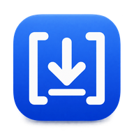
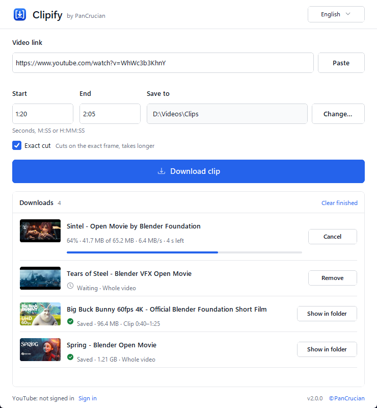
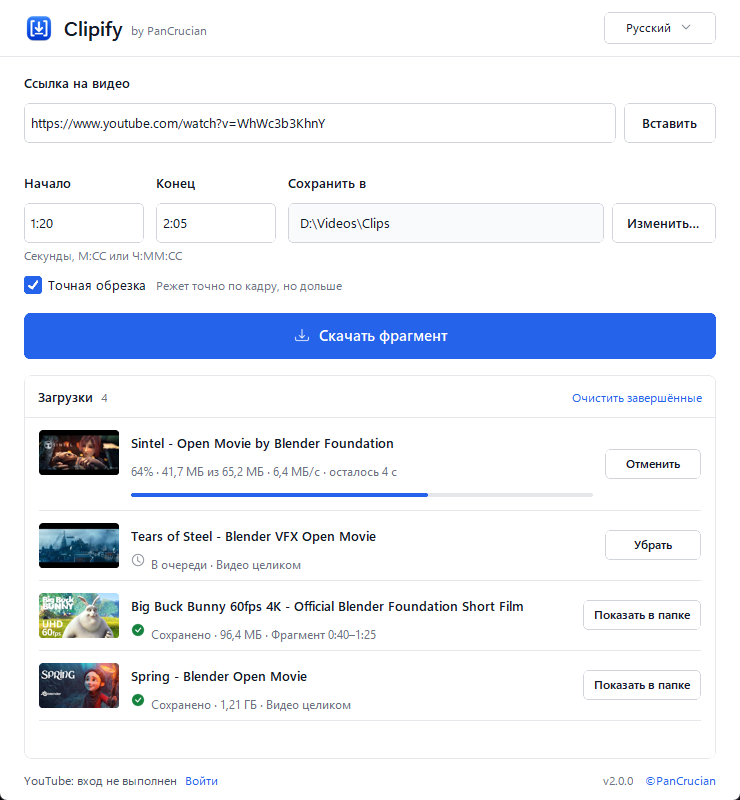

<p align="center">
  
</p>

<h1 align="center">Clipify — YouTube video and clip downloader</h1>

<p align="center">
  Free, portable app for Windows and macOS. Download a whole YouTube video or only the part you need, by start and end time. No installation.
</p>

<p align="center">
  <a href="https://github.com/gusappint/Clipify/releases/latest/download/Clipify-windows-x86_64.zip"><b>Download for Windows</b></a>
  ·
  <a href="https://github.com/gusappint/Clipify/releases/latest/download/Clipify-darwin-arm64.zip"><b>macOS (Apple Silicon)</b></a>
  ·
  <a href="https://github.com/gusappint/Clipify/releases/latest/download/Clipify-darwin-x86_64.zip"><b>macOS (Intel)</b></a>
  <br>
  <a href="https://gusappint.github.io/Clipify/">Website</a> · <a href="#русский">Русский</a> · <a href="https://github.com/gusappint/Clipify/releases/latest">All releases</a>
</p>

<p align="center">
  <picture>
    <source media="(prefers-color-scheme: dark)" srcset="docs/assets/clipify-window-dark-en.png">
    
  </picture>
</p>

**Current version: 2.0.0**

## Download part of a YouTube video in three steps

1. Copy the video’s link in your browser and press **Paste** in Clipify.
2. To save only a fragment, fill in **Start** and **End**: seconds, `M:SS` or `H:MM:SS`. Leave both empty to get the whole video.
3. Press **Download clip** (or **Download video**). When the row says **Saved**, press **Show in folder**.

Unzip the archive anywhere and run Clipify. There is no installer, and you don’t need Python, FFmpeg or yt-dlp on your computer.

## What Clipify does

- **Clips by time.** Downloads only the stretch between Start and End, not the whole video.
- **Exact cut.** Turn it on when the first and last frame matter. It takes longer.
- **Best available quality.** Picks YouTube’s best video and audio and joins them into one file, usually MP4 or WebM.
- **A real queue.** Add several links; each one shows progress, size, speed and time left, and can be cancelled or retried.
- **Safe files.** Never overwrites anything: a name clash gets a numbered copy. Odd characters and very long titles become safe file names.
- **Sign-in only when YouTube asks.** For “Sign in to confirm you’re not a bot”, age checks or private videos shared with you, sign in once in a separate browser window.
- **English and Russian**, light and dark theme, Windows 10/11 (64-bit) and macOS 11 or later.
- **No ads, no account, no telemetry.**

## Questions

### How do I download only part of a YouTube video?
Paste the link, type the start and end time (for example `1:20` and `2:05`) and press **Download clip**. Clipify downloads only that stretch. Turn on **Exact cut** if the clip must begin and end on the exact frame.

### Is Clipify free?
Yes. There are no ads, no paid tier and no account. The source code is in this repository.

### Do I need to install anything?
No. Download the ZIP for your system, unzip it and run Clipify. Everything it needs is inside the archive.

### Where are my videos saved?
In the Clipify folder unless you choose another one with **Change…**. Clipify remembers the folder you pick.

### Why does YouTube ask me to sign in?
YouTube sometimes asks to confirm you’re not a bot, checks your age, or limits a video to certain accounts. Press **Sign in** at the bottom of the window. A separate Chrome, Edge or Brave window opens; sign in to Google there. Clipify picks up the YouTube session, closes that window and uses the session for later downloads.

### Is signing in safe?
Clipify never sees your password; you type it into Google’s own page. It keeps only the YouTube cookies, in `clipify-youtube-cookies.txt` next to the app. That file gives access to your YouTube account, so don’t share it. Delete it to sign out.

### macOS says Clipify can’t be opened
The macOS builds are not signed by Apple. Open **System Settings → Privacy & Security** and press **Open Anyway** next to the Clipify message, then run the app again.

### Something went wrong. Where are the details?
Every error in the window says what to do next. Technical details go to `clipify.log` next to the app; attach it if you report a problem.

## Русский

Clipify — бесплатная программа для Windows и macOS, которая скачивает видео с YouTube целиком или только нужный фрагмент по времени начала и конца. Установка не нужна.

[Скачать для Windows](https://github.com/gusappint/Clipify/releases/latest/download/Clipify-windows-x86_64.zip) · [macOS (Apple Silicon)](https://github.com/gusappint/Clipify/releases/latest/download/Clipify-darwin-arm64.zip) · [macOS (Intel)](https://github.com/gusappint/Clipify/releases/latest/download/Clipify-darwin-x86_64.zip) · [Сайт](https://gusappint.github.io/Clipify/ru/)

<p align="center">
  <picture>
    <source media="(prefers-color-scheme: dark)" srcset="docs/assets/clipify-window-dark-ru.png">
    
  </picture>
</p>

### Как скачать фрагмент видео с YouTube

1. Скопируйте ссылку на видео в браузере и нажмите **Вставить** в Clipify.
2. Чтобы сохранить только фрагмент, укажите **Начало** и **Конец**: секунды, `М:СС` или `Ч:ММ:СС`. Если оставить поля пустыми, скачается всё видео.
3. Нажмите **Скачать фрагмент** (или **Скачать видео**). Когда в строке появится **Сохранено**, нажмите **Показать в папке**.

Распакуйте архив в любую папку и запустите Clipify. Устанавливать ничего не нужно: Python, FFmpeg и yt-dlp уже внутри.

### Что умеет Clipify

- **Фрагменты по времени.** Скачивает только отрезок между началом и концом, а не всё видео.
- **Точная обрезка.** Включите, если важны точные первый и последний кадры. Обработка займёт больше времени.
- **Лучшее доступное качество.** Берёт лучшие видео и звук YouTube и соединяет их в один файл, обычно MP4 или WebM.
- **Очередь загрузок.** Добавляйте несколько ссылок: у каждой видны прогресс, размер, скорость и оставшееся время, любую можно отменить или повторить.
- **Файлы в безопасности.** Ничего не перезаписывает: при совпадении имени создаётся копия с номером. Неудобные символы и слишком длинные названия превращаются в безопасные имена файлов.
- **Вход — только когда YouTube просит.** Для проверки «подтвердите, что вы не бот», возрастных ограничений и приватных видео, к которым вам открыли доступ, достаточно один раз войти в отдельном окне браузера.
- **Русский и английский** интерфейс, светлая и тёмная тема, Windows 10/11 (64-бит) и macOS 11 и новее.
- **Без рекламы, аккаунтов и телеметрии.**

### Вопросы

**Как скачать только часть видео с YouTube?** Вставьте ссылку, укажите начало и конец (например, `1:20` и `2:05`) и нажмите **Скачать фрагмент**. Clipify скачает только этот отрезок. Включите **Точную обрезку**, если фрагмент должен начинаться и заканчиваться точно по кадру.

**Это бесплатно?** Да: без рекламы, платных функций и регистрации. Исходный код — в этом репозитории.

**Куда сохраняются видео?** В папку Clipify, если не выбрать другую кнопкой **Изменить…**. Выбранную папку Clipify запоминает.

**Почему YouTube просит войти?** YouTube иногда просит подтвердить, что вы не бот, проверяет возраст или открывает видео только определённым аккаунтам. Нажмите **Войти** внизу окна: откроется отдельное окно Chrome, Edge или Brave, войдите там в Google. Clipify подхватит сессию YouTube, закроет окно и будет использовать сессию дальше.

**Это безопасно?** Пароль вы вводите на странице Google, Clipify его не видит. Программа сохраняет только cookies YouTube в файле `clipify-youtube-cookies.txt` рядом с собой. Этот файл даёт доступ к аккаунту YouTube — не передавайте его другим. Чтобы выйти, удалите файл.

**macOS пишет, что Clipify нельзя открыть.** Сборки для macOS не подписаны Apple. Откройте **Системные настройки → Конфиденциальность и безопасность** и нажмите **Всё равно открыть** рядом с сообщением о Clipify.

**Что-то пошло не так. Где подробности?** Каждая ошибка в окне подсказывает, что делать дальше. Технические подробности записываются в `clipify.log` рядом с программой — приложите его, если сообщаете о проблеме.

## Run from source

Python 3.11 or newer is recommended.

```bash
python -m venv .venv
# Windows: .venv\Scripts\activate
# macOS/Linux: source .venv/bin/activate
python -m pip install -r requirements.txt
python main.py
```

During development, Deno can be in `PATH`, in `tools/`, beside the app, or at `%USERPROFILE%\deno.exe` on Windows.

## Test and build

```bash
python -m pytest
python -m pip install -r requirements-dev.txt
python scripts/build.py --fetch-deno
```

PyInstaller builds native applications, so run the build on each target operating system. The GitHub Actions workflow builds Windows x64, macOS Apple Silicon and macOS Intel packages. Pushing a `v*` tag publishes all three ZIP files as a GitHub Release.

## Project layout

- `main.py` — app entry point.
- `ytclip/ui.py` — window, downloads queue and sign-in flow.
- `ytclip/theme.py` — colours, type and spacing tokens.
- `ytclip/i18n.py` — English and Russian interface copy, size and time formatting.
- `ytclip/worker.py` — isolated download worker and error classification.
- `ytclip/timecode.py` — time parsing and validation.
- `ytclip/version.py` — current application version.
- `scripts/build.py` — native build and ZIP packaging.
- `scripts/generate_icon.py` — app icon and interface glyphs.
- `docs/` — the website published with GitHub Pages.
- `PRODUCT.md`, `DESIGN.md` — product context and design system.
- `.github/workflows/build-portable.yml` — Windows and macOS release builds.

Clipify is built on [yt-dlp](https://github.com/yt-dlp/yt-dlp) and [FFmpeg](https://ffmpeg.org/). See [THIRD_PARTY_NOTICES.md](THIRD_PARTY_NOTICES.md).
